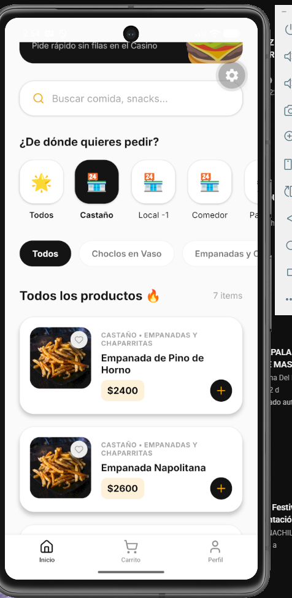
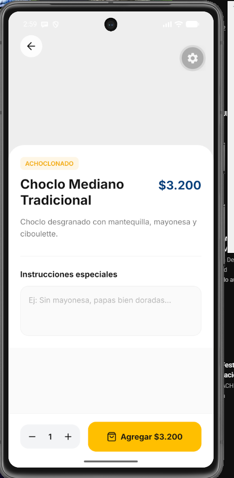
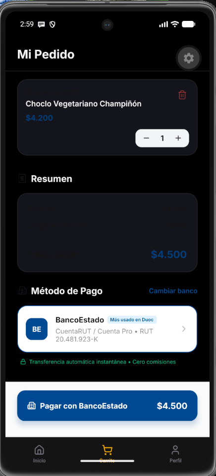
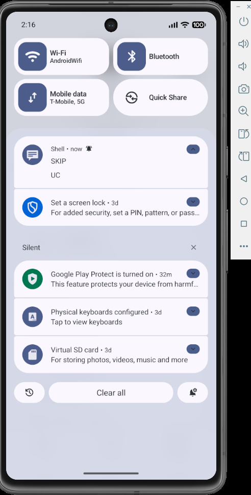
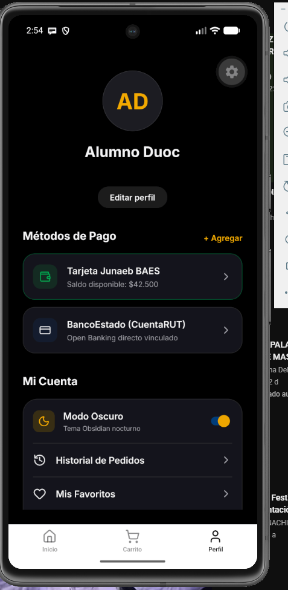
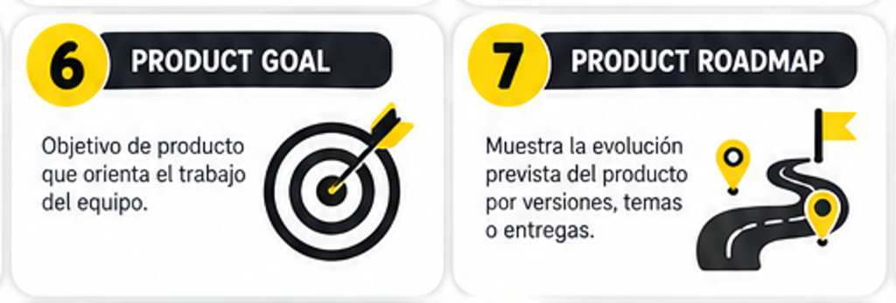

# Manual de Usuario Final
## Sistema SKIP Duoc UC - Sede San Joaquín
**Guía Paso a Paso para Estudiantes y Locatarios**

---

## 1. Introducción al Ecosistema SKIP Duoc UC

**SKIP Duoc UC** es la solución tecnológica diseñada para eliminar las filas en los recreos y horarios de almuerzo de la Sede San Joaquín. Permite a los estudiantes pedir comida de manera anticipada desde su teléfono celular (*Click & Collect*) y retirar sin esperas en el mesón del casino o kiosco, mientras que los concesionarios gestionan las órdenes en tiempo real desde un tablero táctil optimizado para cocina.

---

## 2. Guía del Estudiante (Aplicación Móvil)

### 2.1. Acceso y Registro Institucional
Para resguardar los beneficios arancelarios y convenios de la sede, el acceso está reservado exclusivamente a la comunidad Duoc UC.

1. Abre la aplicación **SKIP SJ** en tu teléfono Android o iOS.
2. Ingresa tu correo institucional terminado en `@duocuc.cl` o `@profesor.duoc.cl`.
3. Ingresa tu contraseña segura (mínimo 6 caracteres).
4. Si es tu primera vez, selecciona la pestaña **"Crear Cuenta"** e ingresa tu nombre completo. Al registrarte, tu perfil quedará automáticamente creado en la base de datos institucional.

---

### 2.2. Exploración del Catálogo y Selección de Locales
En la pantalla de inicio podrás visualizar los locales gastronómicos habilitados en el campus: **Castaño, Achoclonado, Comedor Central, Cafetería Paradiso y Local -1**.

* **Selector de Locales:** Toca cualquiera de las tarjetas circulares en la parte superior para ver únicamente la carta del local seleccionado.
* **Filtro de Categorías:** Puedes navegar horizontalmente por categorías como *Choclos en Vaso, Empanadas y Chaparritas, Bollería, Almuerzos Junaeb, Cafetería y Frituras*.
* **Buscador Rápido:** Utiliza la barra superior para buscar alimentos por nombre (ej: "empanada", "café", "choclo").

---

### 2.3. Personalización del Pedido y Notas de Cocina
Al tocar cualquier producto del catálogo, se abrirá la vista detallada donde puedes configurar tu comida antes de añadirla a la bolsa.

1. **Ajuste de Cantidad:** Utiliza los botones `+` y `-` para elegir cuántas unidades deseas.
2. **Instrucciones Especiales:** En la casilla *"Ej: Sin mayonesa, papas bien doradas..."*, escribe cualquier indicación especial para cocina (ej: *"Sin cebolla"*, *"Muy caliente"*, *"Salsa aparte"*). Estas notas llegarán directamente a la pantalla del cocinero.
3. **Marcar como Favorito:** Toca el botón con forma de **Corazón** en la esquina superior derecha para guardar el alimento en tu lista personal de favoritos y pedirlo en un clic en el futuro.
4. **Agregar:** Presiona el botón amarillo **"Agregar $X.XXX"** para incluirlo en tu pedido.

---

### 2.4. Carrito de Compras y Checkout con Pago Bancario
Una vez agregados tus alimentos, dirígete a la pestaña **"Carrito"** en la barra de navegación inferior.

1. **Revisión del Carrito:** Comprueba los productos, cantidades y tus notas de preparación asignadas.
2. **Resumen de Cobro:** Verifica el desglose de Subtotal, Cargo por Servicio ($300) y el Total a Pagar en pesos chilenos.
3. **Método de Pago:** Selecciona tu medio de pago preferido:
   * **BancoEstado (CuentaRUT):** Transferencia directa e instantánea mediante protocolo Open Banking sin comisión.
   * **Tarjeta Junaeb BAES:** Validación para canje de saldo en almuerzos institucionales de la sede.
4. **Pagar Pedido:** Presiona el botón principal de pago. El sistema procesará la autorización bancaria de forma segura en 1 segundo y generará tu pedido.

---

### 2.5. Código de Retiro y Notificaciones de Entrega
Al confirmar la compra, el sistema te asignará un **Código de Retiro Único de 4 Caracteres** (ejemplo: `K9X2`, `B3MR`).

* **Seguimiento en Vivo:** En la parte superior de tu pantalla de inicio aparecerá una tarjeta informativa con el estado del pedido:
  * 🟡 **Pedido recibido:** Tu orden está en la cola del casino.
  * 🟠 **En preparación:** La cocina está elaborando tu comida.
  * 🟢 **Listo para retirar:** ¡Tu comida te espera en el mesón!
* **Retiro en Mesón:** Acércate al mesón del local, menciona tu código de 4 caracteres y retira tu bolsa sin hacer la fila de pago.

---

### 2.6. Mi Cuenta, Personalización y Modo Oscuro (Obsidian)
En la pestaña **"Perfil"**, puedes personalizar tu experiencia de usuario:

* **Modo Oscuro (Obsidian Theme):** Activa el interruptor *"Modo Oscuro"* para cambiar la interfaz a un elegante fondo nocturno negro azabache (`#09090B`) que ahorra batería en pantallas OLED y mejora la visibilidad en ambientes con poca luz.
* **Editar Perfil:** Pulsa en *"Editar perfil"* para definir tu **apodo** (nombre corto con el que te llamará el personal de cocina), revisar tus datos institucionales y actualizar tu avatar.
* **Historial de Pedidos:** Revisa las boletas digitales de tus compras pasadas y códigos canjeados.

---

## 3. Guía del Locatario (Dashboard Web de Cocina)

### 3.1. Acceso al Terminal de Cocina
El personal de cocina y cajeros accede al Dashboard web desde cualquier tablet o pantalla táctil en el mesón ingresando a la URL del sistema (ej: `http://localhost:5173/` o dominio de producción).

---

### 3.2. Gestión de Comandas en el Tablero Kanban
El tablero organiza visualmente la carga de trabajo en 4 columnas intuitivas:

1. **Pendiente / Pagado (Cola de Entrada):**
   * Cada vez que un alumno paga desde su app, la comanda ingresa automáticamente con una campanilla de aviso auditivo (*Web Audio Chime*).
   * Muestra el número de pedido, el nombre o apodo del alumno, la hora del pedido y el **Código de Retiro destacado**.
   * Las notas especiales del alumno (ej: *"Sin kétchup"*) se exhiben en una caja ámbar de alta visibilidad.
2. **En Preparación:**
   * Al comenzar a elaborar la orden, el cocinero pulsa el botón **"Pasar a Cocina"**. La tarjeta se traslada de columna y la app del alumno cambia su estado a *En preparación*.
3. **Listo para Retiro:**
   * Al emplatar o embolsar el pedido, se presiona **"Listo en Mesón"**. La tarjeta se tiñe de verde y el alumno recibe la notificación de que su pedido está listo para ser retirado.
4. **Completado:**
   * Cuando el estudiante dicta su código en el mesón y recibe su comida, el operario pulsa **"Entregar"** para archivar la comanda y registrar la venta.

---

### 3.3. Control de Menú y Disponibilidad en Vivo
Si un insumo se agota repentinamente en cocina (por ejemplo, se acabaron los champiñones o el queso):

1. Dirígete a la pestaña **"Productos"** en el menú lateral.
2. Localiza el producto mediante la barra de búsqueda rápida.
3. Desactiva el interruptor de **Disponibilidad**.
4. Al instante, el producto desaparecerá del catálogo de la aplicación móvil de los estudiantes, evitando pedidos que no se puedan despachar.

---

### 3.4. Copiloto Gastronómico Inteligente (IA Gemini 3 Flash)
En la sección **"Copiloto IA"**, el administrador del local cuenta con un asesor automatizado:

* **Diagnóstico de Flujo:** Detecta si los pedidos se están acumulando más de 12 minutos en mesón y sugiere redestinar un ayudante a despacho.
* **Estrategia de Upselling:** Analiza qué productos se venden juntos habitualmente y recomienda promociones de combos (ej: *"Ofrece bebida en lata con la empanada por $600 adicionales"*) estimando el incremento de facturación diaria.
